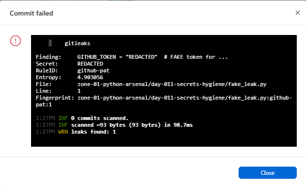

# Day 11: Secrets hygiene
**Zone 1: Python Arsenal** · Completed: Nov 25, 2026

## What it does
| File | Purpose |
|---|---|
| `secrets_demo.py` | Loads an API key from `.env` with python-dotenv and only ever prints it masked |
| `.env.example` | Committed template showing which settings exist (no real values) |
| `make_fake_leak.py` | Generates a **fake** GitHub token file to test secret detection |
| `.env` | Real settings, **never committed** (ignored by `.gitignore`) |

## How to run
```
python -m pip install python-dotenv
copy .env.example .env        # then fill in real values
python secrets_demo.py
gitleaks git . --redact -v    # scan the repo's full history (from repo root)
```

## Results

**Layer 1: secrets out of code**
| Check | Result |
|---|---|
| `python secrets_demo.py` | ✅ `Loaded API_KEY: demo******************3456`: used, never shown in full |
| `git check-ignore -v .env` | ✅ `.gitignore:131:.env`: Git will never track it |

**Layer 3: audit the full history**
| Scan | Result |
|---|---|
| `gitleaks git . --redact -v` | ✅ 13 commits, ~246 KB scanned: **no leaks found** |
| `gitleaks dir fake_leak.py` (planted fake token) | 🚨 Detected: `RuleID: github-pat`, entropy 4.90, secret shown as REDACTED |

**Layer 2: block secrets before they're committed**
| Test | Result |
|---|---|
| Commit `fake_leak.py` through GitHub Desktop | ❌ **Commit failed**: gitleaks pre-commit hook blocked it |



## What I learned
- Deleting a secret doesn't remove it: Git history keeps it, so prevention and history audits both matter.
- Three layers: `.env` + `.gitignore`, a pre-commit hook, and full-history scans.
- gitleaks spots secrets by known patterns (like `ghp_` GitHub tokens) plus entropy (randomness).
- Hooks live in `.git/hooks`, so they only protect my machine. Shared enforcement belongs in CI (Day 83).
- GitHub Desktop ships its own private Git. Installing Git for Windows made `git` usable in the terminal.

## Key notes
### New today
| Term | What it does |
|---|---|
| Secret / API key | A password-like value that grants access to a service |
| `.env` file | Local file of settings and secrets, kept out of Git |
| `.env.example` | Committed template listing settings without real values |
| Environment variable | A named setting a program reads from its environment |
| `import os` / `os.getenv(name, default)` | Reads an environment variable, with a fallback |
| python-dotenv / `load_dotenv()` | Loads `.env` values into environment variables |
| Masking | Showing only part of a secret, e.g. `demo****3456` |
| gitleaks | Open-source scanner for secrets in code and Git history |
| `gitleaks git .` / `gitleaks dir <path>` | Scan the full Git history / scan files on disk |
| `--redact` / `-v` | Hide secrets in the report / verbose detail |
| RuleID / fingerprint | Which detection rule matched / a unique ID for the finding |
| Pre-commit hook | Script Git runs before every commit; can block it |
| `.git` folder / `.git\hooks` | Git's hidden data folder / where hook scripts live |
| `#!/bin/sh` | "Shebang": tells the system which shell runs the script |
| Git for Windows | Standalone Git for the terminal (GitHub Desktop's copy is private) |
| `git check-ignore -v <file>` | Shows which `.gitignore` rule ignores a file |
| `winget install --id <name> -e` | Installs software from Windows' package manager |
| `Set-Content -NoNewline -Encoding ascii` | Writes a file exactly as given (PowerShell) |
| `` `n `` | Newline inside a PowerShell string |
| `import secrets` / `secrets.choice()` | Cryptographically secure random choices |
| `string.ascii_letters` | All letters a–z and A–Z |
| `open(path, "w")` | Opens a file for writing (replaces its contents) |
| `"*" * n` | Repeats text n times |
| `s[-4:]` | Negative slicing: the last 4 characters |

### Already seen
`.gitignore` (Day 1) · `--version` (Day 1) · entropy (Day 4) · `import string` (Day 4) · `"".join()` (Day 9) · slicing `s[:4]` (Day 7) · `Get-Content` (Day 6) · `python -m pip install` (Day 5) · f-strings (Day 2) · `with open` (Day 2) · `if not` (Day 2) · `cd` (Day 1)